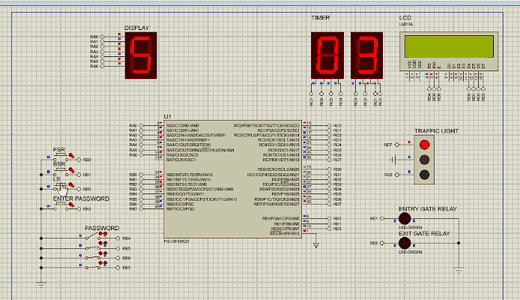
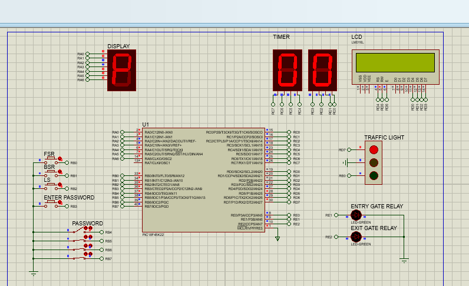
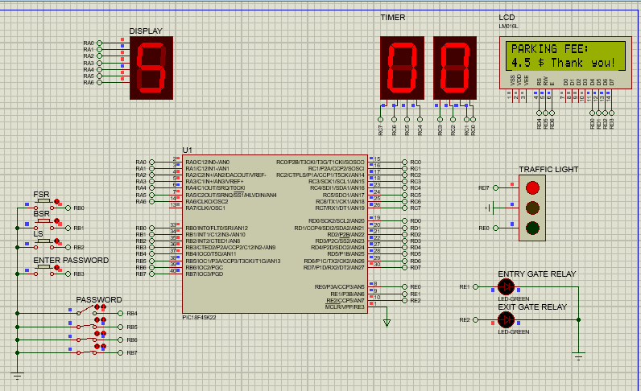

# PIC18 Automated Car Parking System

A microcontroller-based **automated car-parking access and billing system** designed in **Embedded C** for the **Microchip PIC18F45K22**, with a circuit simulated using **Proteus**.

The system uses vehicle detection inputs, a four-bit password, gate and traffic-light outputs, timer displays, and a 16×2 LCD for parking charges. Its timer and control logic are implemented with PIC18 register configuration and interrupts.

**Contributors:** Ahmad Mansour and Ziad Hamade  
**Environment:** MPLAB X IDE / Microchip C18 (legacy project configuration), Proteus 8  
**Platform:** PIC18F45K22 (microcontroller simulation; not a standalone Windows EXE)

## 🎥 Simulation demonstration

**Click the animated preview below to open the full Proteus demonstration video:**

[](media/parking-simulation-demo.mp4)

**[▶ Watch the full simulation demo (MP4, ~29 seconds)](media/parking-simulation-demo.mp4)**

The recording shows the Proteus circuit responding to inputs, the parking timer, the traffic light, and the final LCD parking-fee result. The video is cropped **only around the complete circuit** to remove OBS, the taskbar and unused desktop space; the buttons, PIC, displays and LCD remain visible. The simulation speed is unchanged, and the demo is silent.

*GitHub README files do not play MP4s as a native inline video player; the preview above animates in place, and clicking it opens the included MP4.*

## 📸 Circuit and simulation screenshots

**Proteus schematic (focused circuit view):**


**Password request:**



**Verified fee display:**



These screenshots are cropped to the Proteus schematic only, leaving all circuit components visible. The developer demonstrated the simulation running, including the LCD showing **`PARKING FEE: 4.5 $ Thank you!`**. This is an observed test of one sequence, not proof that every possible condition has been validated.

## ✨ Features

- **Vehicle arrival detection** using pushbutton-modeled sensor inputs.
- **Password-controlled entry**, with four input bits RB7–RB4 (default value `0001`).
- **Entry and exit gate indicators**, traffic-light output and seven-segment status display.
- **Parking duration tracking** using Timer0 and the timer display.
- **Fee calculation**: free for a recorded count of 3 or less; otherwise half of the recorded count, with `.5` shown for odd counts.
- **16×2 LCD feedback** showing the fee or a thank-you message.

> The fee/timing behavior follows the original course prototype's simulation units and source code. It is a demonstration, not a calibrated real-world commercial billing system.

## ▶️ Quick start: run in Proteus

1. Install/access a **licensed Proteus VSM** edition that supports **PIC18** and the **alphanumeric LCD** simulation models.
2. Open [`simulation/CarParking.pdsprj`](simulation/CarParking.pdsprj) in Proteus.
3. Double-click the **PIC18F45K22 (U1)** and set **Program File** to this repository's [`firmware/CarParking.hex`](firmware/CarParking.hex). The original design may reference an outdated local computer path; update it on your PC.
4. Start the simulation with **Play**.
5. Use the input controls in order: **FSR → password switches → ENTER PASSWORD → BSR → LS**. See the [step-by-step simulation guide](docs/SIMULATION_GUIDE.md).

The prebuilt HEX is included so **recompiling is not required to run the Proteus simulation**. Proteus itself is third-party licensed software and is not included in this repository.

## 🧩 Build from embedded C source

The original source is in [`MPLAB_Project/CarParking.X`](MPLAB_Project/CarParking.X/), including `CarParking.c`, header files, MPLAB project XML and makefiles. The project configuration identifies **Microchip C18 v3.47**, a legacy compiler. Opening or rebuilding it may require a compatible older MPLAB X/C18 environment; installing a current XC8 compiler alone may not compile the unchanged source.

If you successfully rebuild the source, load the resulting HEX in Proteus U1's **Program File** field. The included `firmware/CarParking.hex` came from the original project archive and matched the original build's production HEX byte-for-byte.

## 🔌 Hardware/simulation I/O

| Signal | PIC input/output | Role |
|---|---|---|
| `FSR` | `RB0` / INT0 | Arrival sensor pushbutton |
| `BSR` | `RB1` / INT1 | Vehicle enters parking |
| `LS` | `RB2` / INT2 | Vehicle leaves parking |
| `ENTER PASSWORD` | `RB3` | Submit password |
| `PASSWORD` | `RB4`–`RB7` | Four-bit password entry |
| `PORTA` | Output | Status seven-segment display |
| `PORTC` | Output | Parking timer digits |
| `PORTD` | Output | LCD and traffic-light signals |
| `PORTE` | Output | Gate indicator signals |

## 📁 Project structure

```text
pic18-car-parking-system/
├── MPLAB_Project/
│   └── CarParking.X/
│       ├── CarParking.c
│       ├── BCDLib.h
│       ├── LCD4lib.h
│       ├── LCDdefs.h
│       ├── Makefile
│       └── nbproject/
├── simulation/
│   └── CarParking.pdsprj
├── firmware/
│   └── CarParking.hex
├── screenshots/
│   ├── circuit-overview.png
│   ├── password-prompt.png
│   └── parking-fee.png
├── media/
│   ├── parking-simulation-demo.mp4  # Edited 29 s circuit-only demonstration
│   └── parking-demo-preview.gif     # Animated README preview
├── docs/
│   └── SIMULATION_GUIDE.md
├── .gitignore
└── README.md
```

## ⚠️ Notes and limitations

- This is a **simulation-oriented embedded project**, not a Windows application or parking management website.
- Local HEX paths may need to be corrected when opening the Proteus file on another computer.
- The relay/LED components in the circuit may produce nonfatal Proteus model warnings; the LCD, PIC, and full input sequence require a compatible licensed simulator.
- The source and firmware are from the provided original archive; the C code was **not rewritten** for this portfolio package.
- I have **not independently rebuilt or executed** the provided project in this environment. The simulation screenshots and video are from the developer's successful Proteus run.
- A top-level license is intentionally not asserted for this co-authored course project or any potentially third-party helper code without both authors' agreement and provenance checks.
